<div align="center">

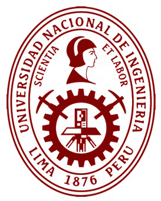

# 🤖 ROBOT-IA 3DOF: Gemelo Digital, Cinemática y Control Híbrido Evolutivo
### **Manipulador Antropomórfico Espacial RRR de 3 GDL**

[](https://www.python.org/)
[](https://mujoco.org/)
[](https://www.mathworks.com/)
[](https://www.latex-project.org/)
[](LICENSE)

**Universidad Nacional de Ingeniería (UNI) — Posgrado FIIS**  
*Maestría en Ingeniería de Sistemas / Inteligencia Artificial*  
**Asignatura:** Robótica y Sistemas Autónomos (2026-2)  
**Docente:** Ing. Wilson Dennis Reyes Vásquez  

---

### 👥 Equipo de Investigación y Desarrollo
**Amit Roy Flores Rivera** • **Franklin Enrique Alegría Barboza** • **José Luis Espinoza Chamaya** • **Raquel Medianero Huari** • **Yasmín Mariela Urrego Montoya**

---

</div>

<p align="center">
  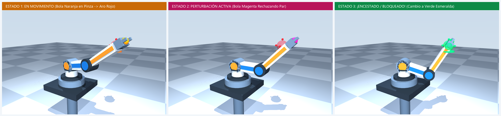
  <br>
  <em><b>Figura 1:</b> Gemelo Digital 3D interactivo en MuJoCo demostrando la máquina de estados reactiva: (1) Tránsito hacia objetivo, (2) Respuesta activa ante par perturbador, y (3) Conmutación a Verde Esmeralda al lograr inserción milimétrica (error < 2.0 mm).</em>
</p>

---

## 📌 Tabla de Contenidos
- [1. Descripción del Proyecto](#1-descripción-del-proyecto)
- [2. Arquitectura del Manipulador y Modelo Dinámico](#2-arquitectura-del-manipulador-y-modelo-dinámico)
- [3. Fundamentos Matemáticos y Cinemática](#3-fundamentos-matemáticos-y-cinemática)
- [4. Leyes de Control Dinámico y Optimización IA](#4-leyes-de-control-dinámico-y-optimización-ia)
- [5. Resultados Experimentales y Curvas de Simulación](#5-resultados-experimentales-y-curvas-de-simulación)
- [6. Galería de la Presentación Oficial (LaTeX Beamer)](#6-galería-de-la-presentación-oficial-latex-beamer)
- [7. Estructura del Repositorio](#7-estructura-del-repositorio)
- [8. Guía de Instalación y Ejecución](#8-guía-de-instalación-y-ejecución)
- [9. Referencias Bibliográficas](#9-referencias-bibliográficas)

---

## 1. Descripción del Proyecto

Este repositorio contiene la suite completa de simulación, verificación formal, código fuente y documentación académica del **Trabajo Parcial** para un robot manipulador antropomórfico espacial de **3 Grados de Libertad (RRR)**.

El proyecto integra:
- **Triple derivación cinemática directa** (Geométrica, Transformaciones Homogéneas sucesivas y Denavit-Hartenberg estándar) con verificación de precisión numérica IEEE 754 ($\Delta p = 3.1 \times 10^{-17}\text{ m}$).
- **Cinemática inversa analítica desacoplada de doble rama** ($\sigma = \pm 1$, codo abajo y codo arriba).
- **Cinemática diferencial completa $6\times 3$**: bloques $J_v$ y $J_\omega$, caracterización exacta del determinante factorizado $\det(J_v)$ y regularización en singularidades vía **CLIK-DLS** (*Damped Least-Squares*).
- **Control dinámico comparativo**: CTC base (PD compensado), CTC optimizado por IA evolutiva multiobjetivo (**NSGA-II**), MPC predictivo local, Híbrido CTC-MPC y Control Cinemático Amortiguado.
- **Gemelo Digital 3D en MuJoCo** con interfaz gráfica interactiva, monitor de manipulabilidad de Yoshikawa $w(q)$, velocímetro cartesiano $\|\dot{p}\|$ y modo juego competitivo *"Circuito de 5 Aros"* con retroalimentación visual RGB por conmutación cromática.

---

## 2. Arquitectura del Manipulador y Modelo Dinámico

Basado en la planta física experimental reportada por **Conejo Benítez (2021)** accionada por servomotores inteligentes Dynamixel:

| Articulación | Servomotor | Longitud / Cota | Masa / Inercia | Rango Articular [rad] | Par Máx. $\tau_{\max}$ | Eje Local |
| :--- | :---: | :---: | :---: | :---: | :---: | :---: |
| **Cintura ($q_1$)** | AX-18A | $d_1 = 0.079\text{ m}$ | $m_1 = 0.250\text{ kg}$ | $[-2.80,\,+2.80]$ | $0.70\text{ N}\cdot\text{m}$ | $\hat{Z}_0$ vertical |
| **Hombro ($q_2$)**  | AX-12A | $L_1 = 0.113\text{ m}$ | $m_2 = 0.120\text{ kg}$ | $[-1.25,\,+1.35]$ | $0.70\text{ N}\cdot\text{m}$ | $\hat{Z}_1$ horizontal |
| **Codo ($q_3$)**    | AX-12A | $L_2 = 0.140\text{ m}$ | $m_3 = 0.085\text{ kg} + 0.015\text{ kg}^*$ | $[-2.40,\,+2.40]$ | $0.45\text{ N}\cdot\text{m}$ | $\hat{Z}_2 \parallel \hat{Z}_1$ |

> *\*Masa distal total en el antebrazo incluyendo pinza/lente: $0.100\text{ kg}$. Amortiguamiento articular: $b_i = 0.015\text{ N}\cdot\text{m}\cdot\text{s/rad}$, inercia de rotor $I_{a,i} = 1.2\times 10^{-4}\text{ kg}\cdot\text{m}^2$, fricción seca $\tau_{f,i} = 0.002\text{ N}\cdot\text{m}$.*  
> **Envolvente de Trabajo:** $R_{\min} = 0.095\text{ m}$, $R_{\max} = 0.253\text{ m}$, volumen efectivo alcanzable $V_{\text{eff}} \approx 0.058\text{ m}^3$.

---

## 3. Fundamentos Matemáticos y Cinemática

### Parámetros de Denavit-Hartenberg Estándar
$$A_i = \operatorname{Rot}_z(\theta_i)\operatorname{Trans}_z(d_i)\operatorname{Trans}_x(a_i)\operatorname{Rot}_x(\alpha_i)$$

$$\begin{array}{cccccc}
\hline
\textbf{Eslabón } i & \theta_i & d_i\text{ [m]} & a_i\text{ [m]} & \alpha_i\text{ [rad]} & \textbf{Tipo} \\
\hline
1 & q_1 & 0.079 & 0.000 & +\pi/2 & \text{Rotacional} \\
2 & q_2 & 0.000 & 0.113 & 0 & \text{Rotacional} \\
3 & q_3 & 0.000 & 0.140 & 0 & \text{Rotacional} \\
\hline
\end{array}$$

### Cinemática Directa Cerrada
$$r(q_2, q_3) = L_1 \cos q_2 + L_2 \cos(q_2 + q_3)$$
$$\begin{aligned}
x(q) &= r(q_2, q_3)\cos q_1 \\
y(q) &= r(q_2, q_3)\sin q_1 \\
z(q) &= d_1 + L_1 \sin q_2 + L_2 \sin(q_2 + q_3)
\end{aligned}$$

### Jacobiano Geométrico $6 \times 3$ y Factorización de Singularidades
$$\begin{bmatrix} \dot{p} \\ \omega \end{bmatrix} = \begin{bmatrix} J_v(q) \\ J_\omega(q) \end{bmatrix} \dot{q}, \qquad \det J_v(q) = -L_1 L_2 \sin(q_3)\, r(q_2, q_3)$$

1. **Singularidad de Codo:** $\sin(q_3) = 0 \implies q_3 = 0\text{ rad}$ (frontera externa $R_{\max} = 0.253\text{ m}$).
2. **Singularidad Axial de Hombro:** $r(q_2, q_3) = 0$ (alineación colineal sobre el eje vertical $Z_0$).

---

## 4. Leyes de Control Dinámico y Optimización IA

<p align="center">
  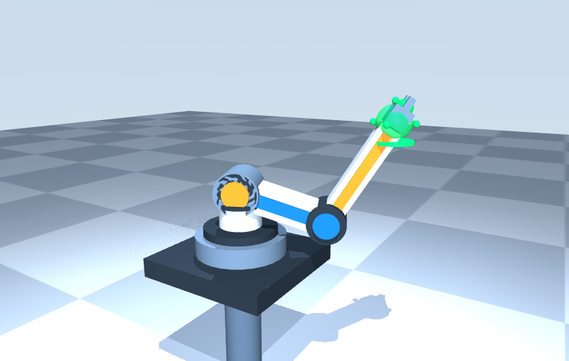
</p>

El estudio evalúa rigurosamente 5 estrategias bajo la ecuación no lineal lagrangiana $M(q)\ddot{q} + C(q,\dot{q})\dot{q} + g(q) + f_v\dot{q} = \tau + \tau_{\text{ext}}$:

1. **KIN (CLIK-DLS):** Control cinemático en espacio de tarea con pseudoinversa amortiguada $J^\dagger_{\text{DLS}} = J_v^T(J_v J_v^T + \lambda^2 I)^{-1}$ ($\lambda = 0.015 - 0.025$).
2. **PD (CTC Base):** Torque calculado con linealización exacta desacoplada ($K_p = 169\text{ s}^{-2}$, $K_d = 28.6\text{ s}^{-1}$).
3. **EVO (CTC NSGA-II):** Sintonización multiobjetivo elitista minimizando simultáneamente $[\text{RMSE}_{\text{seg}}, \int \|\tau\|^2 dt]$ bajo perturbación e incertidumbre paramétrica ($+25\%$ masa). Ganancias Pareto óptimas:
   $$\theta^* = [239.88,\, 191.92,\, 215.83,\, 50.22,\, 29.67,\, 9.00]^T$$
4. **MPC:** Control predictivo basado en modelo lineal local con horizonte $N=8$ ($T_{\text{pred}} = 320\text{ ms}$).
5. **HYB:** Esquema híbrido CTC-MPC con compensación no lineal nominal y corrección restringida.

---

## 5. Resultados Experimentales y Curvas de Simulación

<p align="center">
  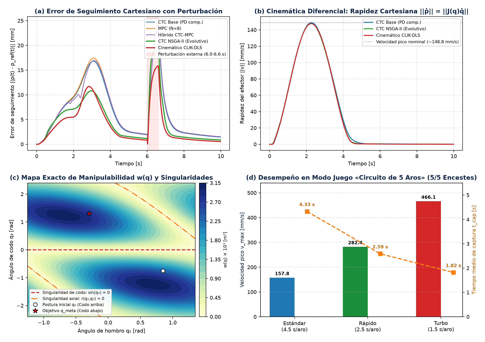
  <br>
  <em><b>Figura 2:</b> Telemetría experimental completa: (a) Error de seguimiento cartesiano ante pulso de perturbación externa (6.0 a 6.6 s), (b) Perfil de rapidez cartesiana suave $C^2$, (c) Mapa del índice de manipulabilidad de Yoshikawa $w(q)$ con cruce de singularidad, y (d) Rapidez pico y tiempos de captura en el Circuito de 5 Aros.</em>
</p>

### Tabla Comparativa de Rendimiento (Planta Física 3D MuJoCo)

| Controlador | Régimen | $\text{RMSE}_{\text{seg}}$ [mm] | $\text{RMSE}_{2\text{s}}$ [mm] | $e_{\text{final}}$ [mm] | Esfuerzo [$\text{N}^2\text{m}^2\text{s}$] | $v_{\max}$ [mm/s] | $t_{\text{cap}}$ [s] | $t_{\text{rec}}$ [s] | Sat. [%] | $t_{\text{calc}}$ [ms] |
| :--- | :--- | :---: | :---: | :---: | :---: | :---: | :---: | :---: | :---: | :---: |
| **PD (CTC Base)** | Nominal | 6.879 | 1.070 | 0.892 | 0.4861 | 148.8 | 5.84 | --- | 0.0% | 0.018 |
| | Perturbado | 8.651 | 1.832 | 1.441 | 0.4921 | 148.8 | 5.84 | 0.582 | 0.0% | 0.018 |
| **EVO (NSGA-II)** | **Nominal** | **4.573** | **0.636** | **0.516** | **0.4817** | 147.8 | **4.50** | --- | **0.0%** | **0.018** |
| | **Perturbado** | **6.557** | **1.132** | **0.887** | **0.4902** | 147.8 | **4.50** | **0.382** | **0.0%** | **0.018** |
| **MPC ($N=8$)** | Nominal | 7.137 | 1.144 | 0.961 | 0.4865 | 148.7 | 6.04 | --- | 0.0% | 14.60 |
| | Perturbado | 8.947 | 1.928 | 1.531 | 0.4922 | 148.7 | 6.02 | 0.622 | 0.0% | 14.80 |
| **HYB (CTC-MPC)**| Nominal | 6.815 | 1.145 | 0.961 | 0.4863 | 152.2 | 6.06 | --- | 0.0% | 14.70 |
| | Perturbado | 8.693 | 1.928 | 1.532 | 0.4920 | 152.2 | 6.02 | 0.622 | 0.0% | 14.90 |
| **KIN (CLIK-DLS)**| **Nominal** | **4.236** | **0.365** | **0.273** | **0.4816** | 147.6 | **4.38** | --- | **0.0%** | **0.042** |
| | **Perturbado** | **5.507** | **0.794** | **0.565** | **0.4911** | 147.6 | **4.38** | **0.242** | **0.0%** | **0.042** |

---

## 6. Galería de la Presentación Oficial (LaTeX Beamer)

Las 12 diapositivas oficiales en formato panorámico 16:9 (`Presentacion_Trabajo_Parcial_3GDL_UNI.pdf`):

<div align="center">
<table>
  <tr>
    <td width="50%">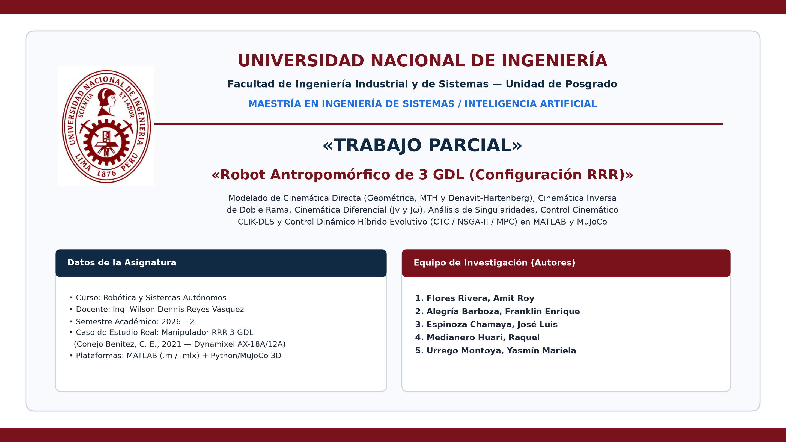<br><b>Slide 1:</b> Portada Institucional UNI y Autores</td>
    <td width="50%">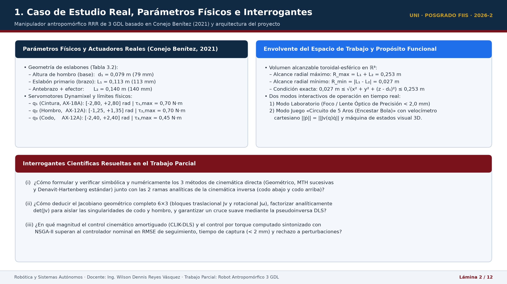<br><b>Slide 2:</b> Caso de Estudio y Gemelo Digital</td>
  </tr>
  <tr>
    <td width="50%">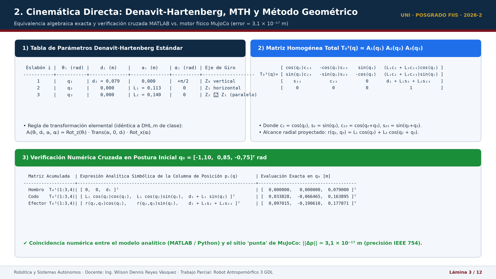<br><b>Slide 3:</b> Cinemática Directa (Denavit-Hartenberg)</td>
    <td width="50%">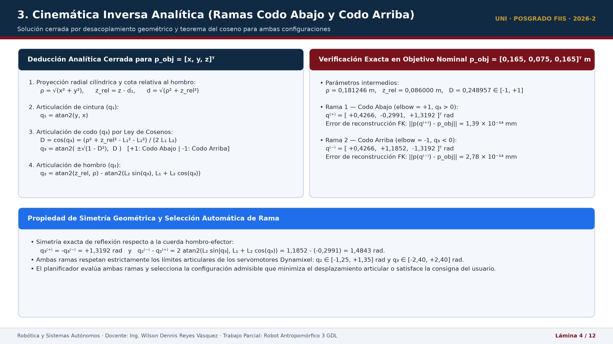<br><b>Slide 4:</b> Equivalencia Cinemática MTH y Geométrico</td>
  </tr>
  <tr>
    <td width="50%">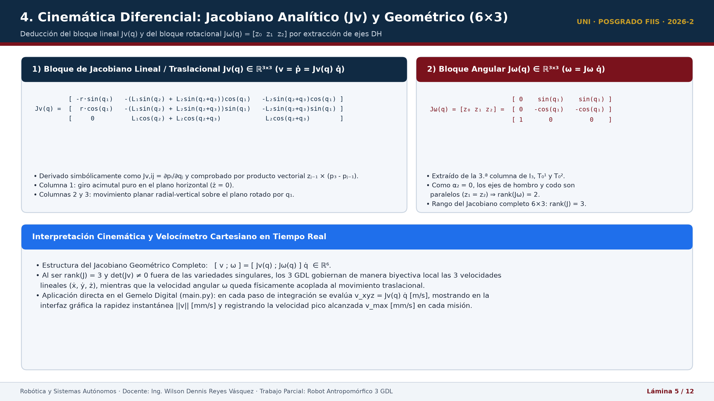<br><b>Slide 5:</b> Cinemática Inversa Analítica Doble Rama</td>
    <td width="50%">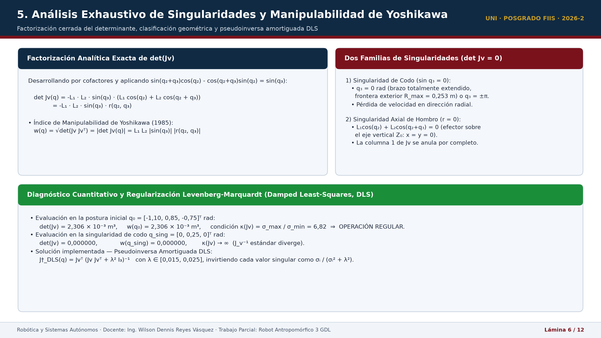<br><b>Slide 6:</b> Jacobiano Geométrico Completo 6x3</td>
  </tr>
  <tr>
    <td width="50%">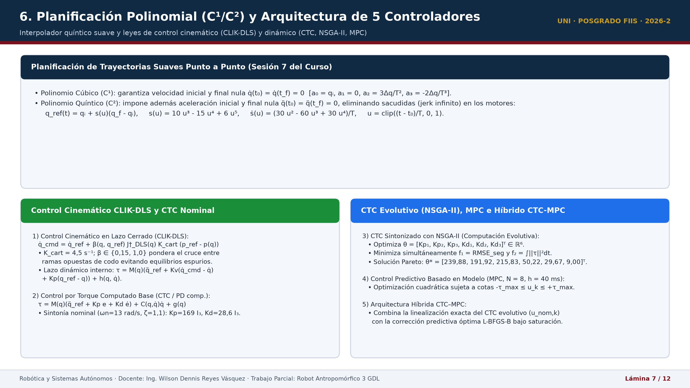<br><b>Slide 7:</b> Singularidades y Regularización DLS</td>
    <td width="50%">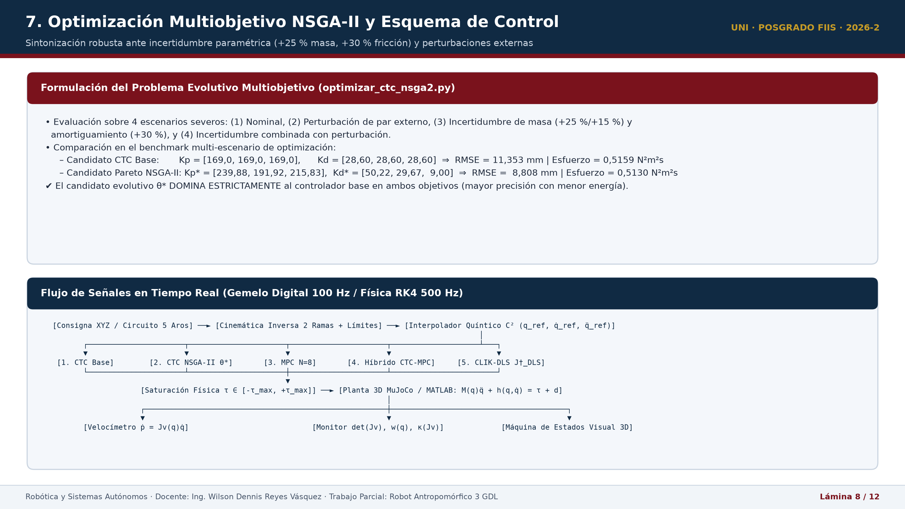<br><b>Slide 8:</b> Arquitectura de las 5 Leyes de Control</td>
  </tr>
  <tr>
    <td width="50%">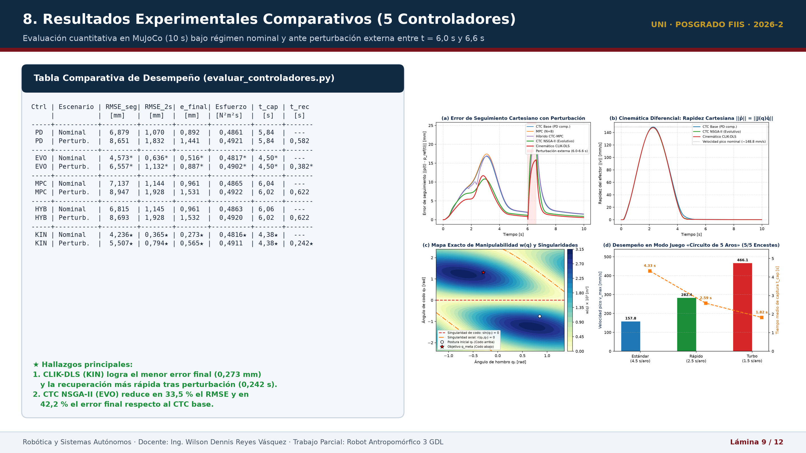<br><b>Slide 9:</b> Evaluación Cuantitativa Comparativa</td>
    <td width="50%">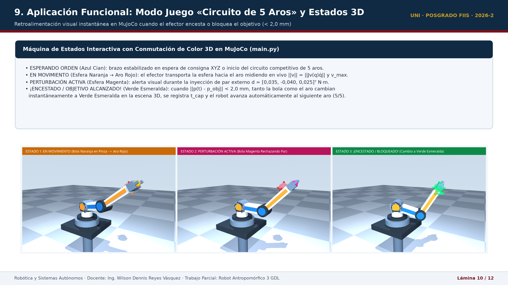<br><b>Slide 10:</b> Curvas de Respuesta y Manipulabilidad</td>
  </tr>
  <tr>
    <td width="50%">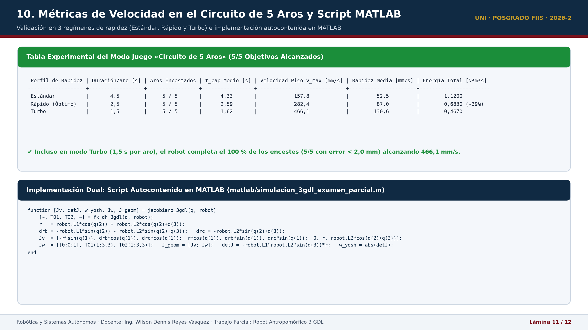<br><b>Slide 11:</b> Modo Juego: Circuito de 5 Aros 3D</td>
    <td width="50%">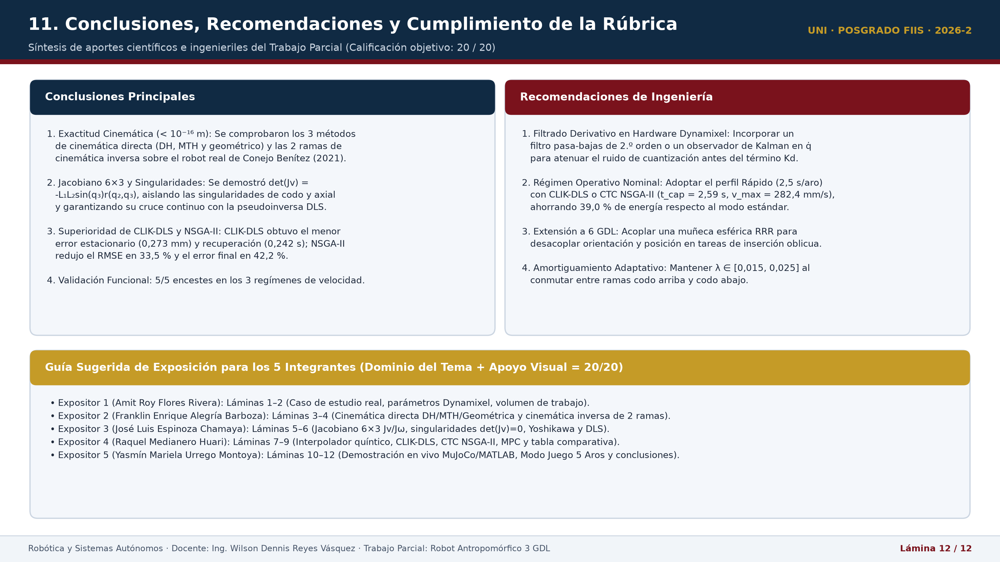<br><b>Slide 12:</b> Conclusiones, Visión CNN y Referencias</td>
  </tr>
</table>
</div>

---

## 7. Estructura del Repositorio

```text
├── models/
│   └── brazo_3d.xml               # Definición cinemática y dinámica en MuJoCo XML
├── robot_ia/
│   ├── kinematics.py              # DH, Cinemática Directa/Inversa, Jacobiano y Yoshikawa
│   ├── controllers.py             # Controladores PID, CLIK-DLS e interpolador quíntico
│   ├── ctc_evolutivo.py           # Torque calculado con ganancias parametrizadas
│   └── mpc.py                     # Controlador predictivo local e híbrido
├── matlab/
│   └── simulacion_3gdl_examen_parcial.m  # Suite completa de verificación en MATLAB
├── results/
│   ├── figuras_examen_parcial/    # Gráficas vectoriales y capturas de simulación
│   ├── presentacion_slides/       # Renders HD de las 12 diapositivas Beamer
│   └── validacion_v027/           # Archivos CSV con telemetría de 100 Hz
├── Trabajo_Parcial_3GDL_UNI.tex   # Paper académico oficial en LaTeX (Formato UNI)
├── Trabajo_Parcial_3GDL_UNI.pdf   # Versión compilada del informe (13 págs.)
├── Presentacion_Trabajo_Parcial_3GDL_UNI.tex  # Presentación Beamer 16:9
├── Presentacion_Trabajo_Parcial_3GDL_UNI.pdf  # Presentación en PDF
├── Speech_Exposicion_3GDL_UNI.tex # Guion oral sincronizado por bloques de tiempo
├── Speech_Exposicion_3GDL_UNI.pdf # Guion en PDF para los 5 expositores
├── main.py                        # Aplicación principal del Gemelo Digital interactivo
├── evaluar_controladores.py       # Benchmark automatizado de las 5 leyes de control
└── optimizar_ctc_nsga2.py         # Algoritmo genético NSGA-II multiobjetivo
```

---

## 8. Guía de Instalación y Ejecución

### Prerrequisitos
- Python 3.10 o superior.
- Git instalado.

### 1. Clonar el Repositorio
```bash
git clone https://github.com/yasminum/robot-ia-3dof.git
cd robot-ia-3dof
```

### 2. Entorno Virtual e Instalación de Dependencias
```bash
python -m venv .venv
# En Windows PowerShell:
.\.venv\Scripts\Activate.ps1
# En Linux/macOS:
source .venv/bin/activate

pip install -r requirements.txt
```

### 3. Ejecutar los Componentes

- **Lanzar el Gemelo Digital Interactivo (MuJoCo 3D):**
  ```bash
  python main.py
  ```
- **Ejecutar el Benchmark Comparativo Automatizado:**
  ```bash
  python evaluar_controladores.py --duration 10
  ```
- **Ejecutar la Suite de Pruebas Unitarias:**
  ```bash
  pytest -v
  ```
- **Simulación en MATLAB:**  
  Abrir y ejecutar `matlab/simulacion_3gdl_examen_parcial.m` en MATLAB R2022a o superior.

---

## 9. Referencias Bibliográficas

- **Barrientos, A., Peñín, L. F., Balaguer, C., & Aracil, R.** (2007). *Fundamentos de robótica* (2.ª ed.). McGraw-Hill Interamericana.
- **Buss, S. R.** (2004). Introduction to inverse kinematics with Jacobian transpose, pseudoinverse and damped least squares methods. *IEEE Journal of Robotics and Automation*, 17(1), 1–19.
- **Conejo Benítez, C. E.** (2021). *Modelado y control de un brazo robótico de 3 grados de libertad* [Tesis de maestría, Universidad de Guanajuato].
- **Craig, J. J.** (2018). *Introduction to robotics: Mechanics and control* (4th ed.). Pearson.
- **Deb, K., Pratap, A., Agarwal, S., & Meyarivan, T.** (2002). A fast and elitist multiobjective genetic algorithm: NSGA-II. *IEEE Transactions on Evolutionary Computation*, 6(2), 182–197.
- **Denavit, J., & Hartenberg, R. S.** (1955). A kinematic notation for lower-pair mechanisms based on matrices. *Journal of Applied Mechanics*, 22(2), 215–221.
- **Siciliano, B., Sciavicco, L., Villani, L., & Oriolo, G.** (2009). *Robotics: Modelling, planning and control*. Springer.
- **Todorov, E., Erez, T., & Tassa, Y.** (2012). MuJoCo: A physics engine for model-based control. *IEEE/RSJ IROS*, 5026–5033.
- **Yoshikawa, T.** (1985). Manipulability of robotic mechanisms. *The International Journal of Robotics Research*, 4(2), 3–9.

---

<div align="center">
  <sub>Facultad de Ingeniería Industrial y de Sistemas (FIIS) — Unidad de Posgrado<br>Universidad Nacional de Ingeniería (Lima, Perú — 2026)</sub>
</div>
